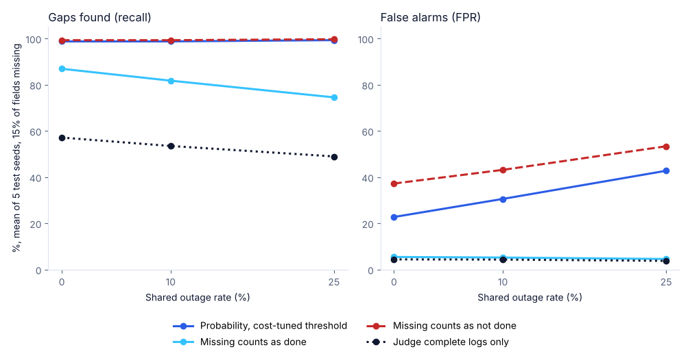

# Correlated Audit Ledger

**Research question:** When the logs of several AI agents go missing, either one field at a time or several agents at once (a shared outage), how well can an auditor still find a skipped duty, and how do common ways of treating missing evidence trade missed gaps against false alarms?

This is a small synthetic benchmark in Python (3.9+, standard library only). It does not call a language model and uses no real logs.

## Setup

- **Agents:** three roles (planner, executor, verifier). In 35% of episodes exactly one role skips its required duty; this is the responsibility gap to find.
- **Logs:** each role writes 3 fields about its duty ("done" or "not done"). Each field is correct with probability 0.9.
- **Missing evidence:**
  - *independent omission:* each field is lost on its own (5%, 15% or 30%);
  - *shared outage:* the log store used by the executor and the verifier fails, and all six of their fields are lost together (0%, 10% or 25% of episodes).
- **Auditor rules:**
  - `strict_complete`: judges a role only when all three of its fields are present (majority says "not done" means a gap).
  - `optimistic_missing`: a missing field counts as "done".
  - `pessimistic_missing`: a missing field counts as "not done".
  - `probability`: the probability that some role skipped its duty, from the fields that are present (a missing field is no evidence either way). The threshold is chosen on training seeds 11, 22 and 33 to minimise weighted cost.
- **Cost:** a missed gap costs 5 and a false alarm costs 1.
- **Test:** seeds 44, 55, 66, 77 and 88, 400 episodes each, never used to choose the threshold.

## Run

```bash
python3 -m unittest discover -s tests -v
python3 run_experiment.py
python3 make_chart.py        # optional, needs matplotlib
```

Outputs in `outputs/`: `results_summary.md` (mean and range over the 5 test seeds), `metrics_by_seed.csv`, `synthetic_test_dataset.csv` (one row per test episode with all nine log fields) and `dataset_card.md`. Fixed seeds, so every run gives the same files.

## Results

From my run (`outputs/results_summary.md`), with 15% of fields missing, mean of the 5 test seeds:

| Shared outage | Rule | Recall | FPR | Weighted cost |
|---:|---|---:|---:|---:|
| 0% | probability (threshold 0.1) | 0.988 | 0.228 | 66.2 |
| 0% | strict_complete | 0.571 | 0.044 | 328.0 |
| 0% | optimistic_missing | 0.869 | 0.054 | 110.6 |
| 0% | pessimistic_missing | 0.993 | 0.372 | 98.8 |
| 25% | probability (threshold 0.1) | 0.993 | 0.428 | 112.8 |
| 25% | strict_complete | 0.490 | 0.038 | 386.4 |
| 25% | optimistic_missing | 0.745 | 0.046 | 199.4 |
| 25% | pessimistic_missing | 0.997 | 0.534 | 136.6 |



- Judging only complete logs missed about half of the skipped duties; counting missing fields as "not done" found almost all of them but flagged 37% to 53% of clean episodes.
- Counting missing fields as "done" lost recall as outages rose (0.869 to 0.745): a duty skipped by an agent whose log was lost looked complete.
- The probability rule had the lowest weighted cost in all 9 settings, but only by flagging every outage episode for review (all 318 clean outage episodes in the 15% / 25% setting).

Article: [When AI agents' logs went missing together, every audit rule either missed gaps or raised false alarms](https://masmatixinnovations.co.uk/insights/correlated-audit-ledger.html)

## Limitations

- Simulated agents and logs, not real agent traces. The field accuracy (0.9), the gap rate (35%) and the 5-to-1 cost are choices of this benchmark.
- The `probability` rule knows the simulator's true accuracy and gap rate, which a real auditor would have to estimate.
- One kind of shared outage (two of three agents at once) and missingness that does not depend on whether the duty was done.

## Changes

- v0.2.0: rebuilt the simulator with three agent roles, per-field logs and shared outages that remove two agents together; rules now do what their names say; five test seeds with ranges. The v0.1.0 rules were all thresholds on one score, and its "strict" and "score threshold" rows were not separate rules.

## License

Code: MIT. Synthetic data and figures: CC BY 4.0. See `LICENSE` and `CITATION.cff`.
